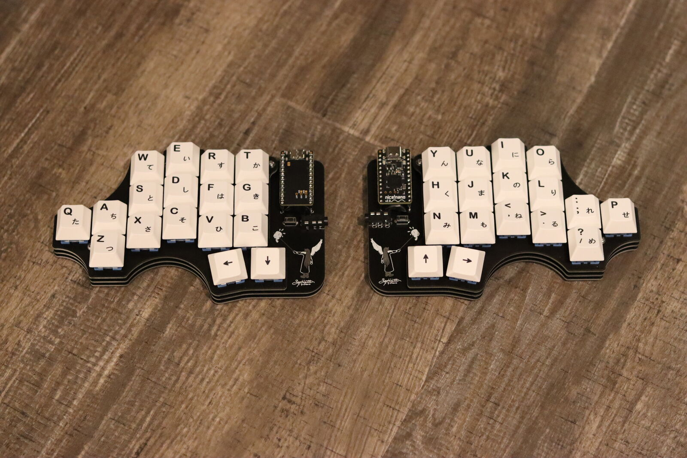
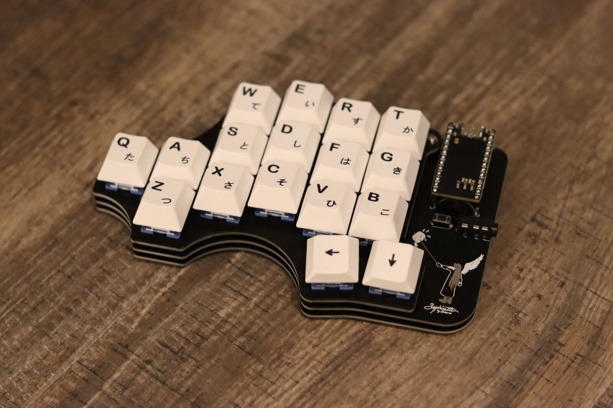

The Sephirette
==============

The Sephirette is a split 34-key keyboard with pinky clusters. It is the split
version of the [Osprette MX][osprette-mx], designed by me, which itself was inspired by
the [Balbuzard][balbuzard] by brow.

The build guide is by pferdem, with review suggestions from Erdem.

# Pictures

[osprette-mx]: https://github.com/smores56/osprette/tree/main/mx
[balbuzard]: https://github.com/brow/balbuzard
