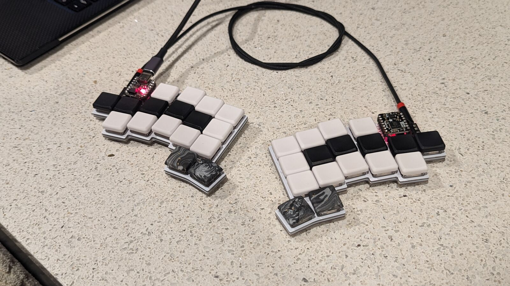
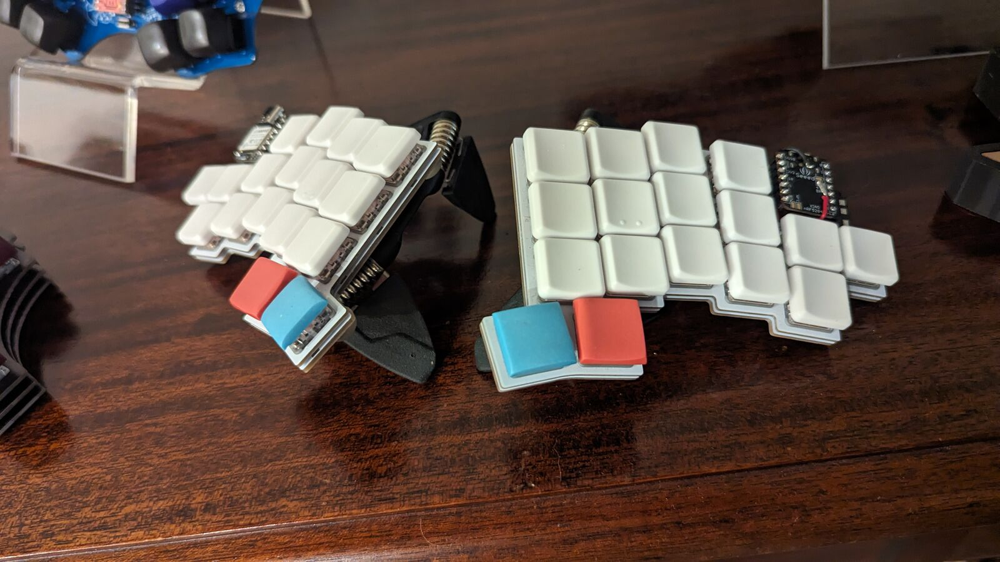

The Clog V4
===========

The Clog V4 is a 34-key split keyboard. It has the following features:

- Choc V1 switches
- Wired or wireless with Seeeduino Xiao controllers
- Pinky clusters (top pinky keys on the sides)
- Splay (4° between middle and ring and between ring and pinky)
- Hotswap with a switch plate for stability
- SplitKB puck support for tenting

## How to Order

The gerber ZIPs ([PCB](./gerber/clog-v4.zip) and [plate](./gerber/clog-v4-plate.zip))
have everything you'll need to get this printed. You can order from [JLC](https://jlcpcb.com)
by just uploading the ZIP archives and keeping the default options. I'd suggest removing
the order number, otherwise they'll put one on the boards somewhere randomly.

## Building

### Parts Needed

Part Name                  | Quantity        | Notes                                    | Link
--------------------------:|:---------------:|:----------------------------------------:|:----
PCB                        | 2 (halves)      |                                          | Look up
Switch Plate               | 2 (halves)      |                                          | Look up
Choc V1 Switches           | 34              |                                          | <https://mkultra.click/choc-switches>
Choc Keycaps               | 34              |                                          | <https://mkultra.click/mbk-factory-colors>
SMD Diodes                 | 34              |                                          | <https://www.aliexpress.com/item/3256802562651339.html>
Kailh Choc Hotswap Sockets | 34              |                                          | <https://mkultra.click/kailh-hotswap-sockets>
Power Switches             | 2               | optional                                 | <https://www.digikey.com/en/products/detail/nidec-copal-electronics/CUS-12TB/1124222>
Reset Switches             | 2               | optional                                 | <https://www.digikey.com/en/products/detail/e-switch/TL1014BF160QG/3910805>
Xiao (BLE)                 | 2               |                                          | <https://www.seeedstudio.com/Seeed-XIAO-BLE-nRF52840-p-5201.html>
Small LiPo Batteries       | 2               |                                          | <https://www.aliexpress.com/item/2251832610867849.html>
Inch of Copper Wire        | 1               | Use thin and sheathed                    | Any hardware store
MCU Sockets                | 1 strip to chop | Optional, chop into sections of 7 pins   | <https://www.digikey.com/en/products/detail/mill-max-manufacturing-corp/316-43-164-41-006000/1212147>
MCU Socket Pins            | 28              | Optional, buy extras, these are slippery | <https://www.digikey.com/en/products/detail/mill-max-manufacturing-corp/3320-0-00-15-00-00-03-0/4147392>

### Tips

I'd solder the parts in this order:

- Diodes
- Hotswap sockets
- Power switches
- MCU sockets/Headers that came with the Xiao's
- MCU pins if you're [socketing](https://docs.splitkb.com/hc/en-us/articles/360011263059-How-do-I-socket-a-microcontroller-)
- Batteries (To the +ve pad under the controller and to the -ve hole on the board)
- The "bodge" wire from the "Reset" hole to the reset pad under the controller

## Pictures

